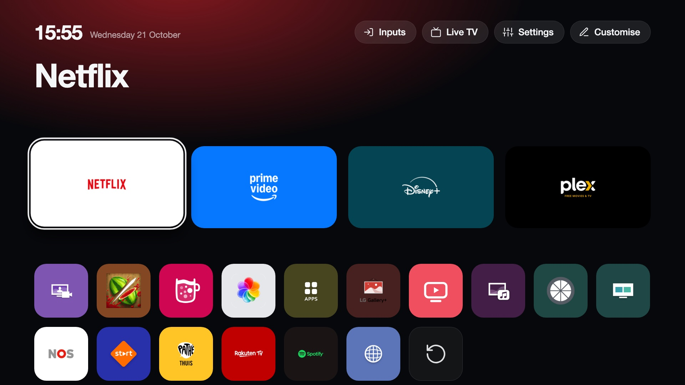
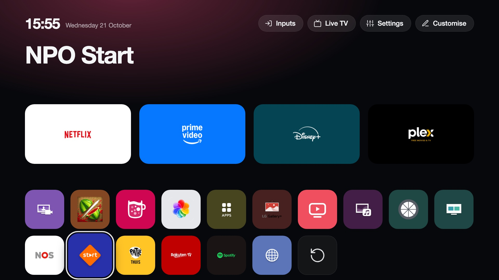
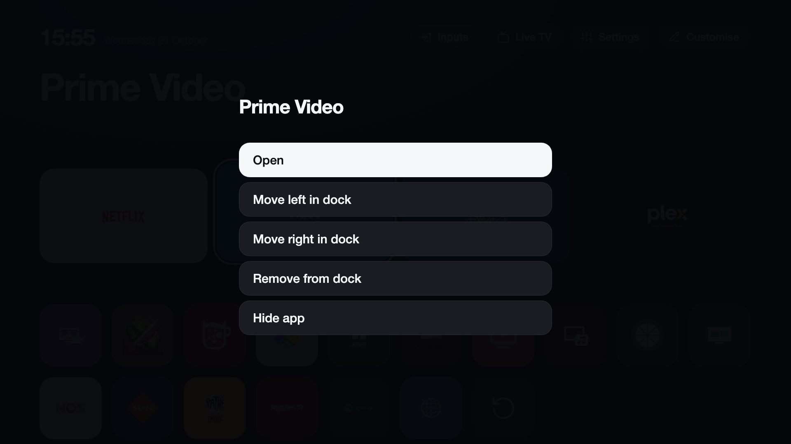
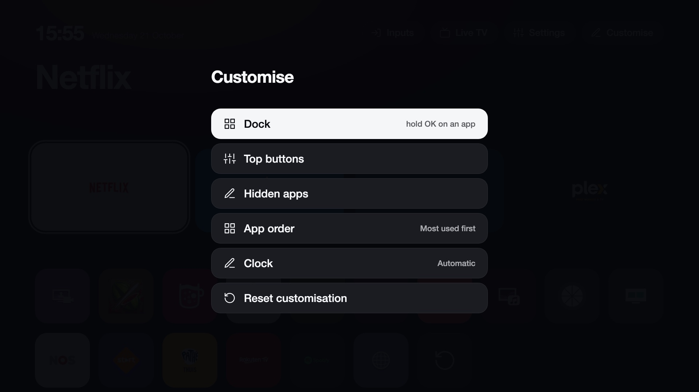
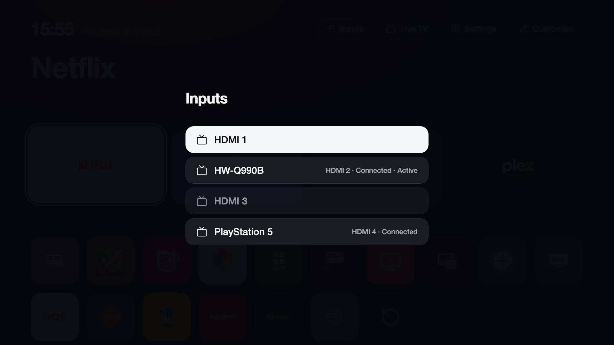

# CleanYourTV for LG webOS

An Apple TV-style home screen for **rooted LG webOS TVs**, plus a debloat of LG's ads and telemetry.
It replaces LG's Home app with a clean launcher: a dock of four favourite apps, a top shelf naming the
focused app with an ambient glow taken from its artwork, an app grid, an Inputs picker, a Settings
shortcut, a built-in Live TV player for your own M3U playlist and a clock, all customisable from the remote. It reads your installed apps live, so new apps show up on their own.

Everything is **RAM-only**. Nothing under `/usr`, `/etc` or the firmware is modified, and a reboot
without the boot scripts brings LG's stock Home back.

> Inspired by [CleanYourTV](https://github.com/Gathin23/cleanyourtv) (Android TV, MIT licensed), whose home-screen design this follows.
> Developed and tested on an LG OLED65G26LA (G2), webOS 10.2.2 / webOS 25. Other models and firmware
> versions should work if they are rooted, but are untested; please report what you find.

<p align="center"></p>

<p align="center"></p>

<table>
<tr>
<td></td>
<td></td>
</tr>
<tr>
<td></td>
<td></td>
</tr>
</table>

## Requirements

- An LG webOS TV that is **already rooted** with the [Homebrew Channel](https://webosbrew.org)
  (see [rootmy.tv](https://rootmy.tv)), and SSH access as `root` (`ssh root@<tv-ip>`).
- The TV needs internet access (the installer downloads this repo) and the tools webOS already ships:
  `curl`, `tar`, `python3` and `node`.

## Install

Run this on your computer. It logs in to the TV and runs the installer there (replace `192.168.1.50`
with your TV's IP):

```sh
ssh root@192.168.1.50 'curl -fsSL https://raw.githubusercontent.com/lasharor/cleanyourtv-WebOS/main/install.sh | sh'
```

Already in an SSH session on the TV? Run just the `curl ... | sh` part.

Options go after `sh -s --`:

| Option | What it does |
|---|---|
| `--no-debloat` | Install the launcher only; leave LG's services and the hosts file alone. |
| `--no-start` | Install, but only take effect at the next reboot. |
| `--no-verify` | Skip the post-install check (see below) and the automatic rollback. |
| `--force` | Continue even if LG's Home app looks different from what the installer expects. |

```sh
ssh root@192.168.1.50 'curl -fsSL https://raw.githubusercontent.com/lasharor/cleanyourtv-WebOS/main/install.sh | sh -s -- --no-debloat'
```

The screen blinks once while the system app manager (`sam`) restarts, then the new Home appears.

**It checks its own work.** After starting, the installer waits for the new Home to be registered with the
system and for the helper to answer with the matching version. If that does not happen within two minutes
it restores LG's Home and removes the boot scripts, so a failed install leaves the TV as it was. It also
prints your TV model and firmware, and warns if it is not a webOS 25 TV (the only one tried so far).

**Updating:** run the same one-liner again, or `sh /media/developer/cleanyourtv/update.sh` on the TV. Your
settings and usage history are kept. If the launcher and helper versions ever differ, the launcher says so.

### What the installer does

1. Checks it is running as root on a rooted webOS TV, and saves the original state (stock Home
   `appinfo.json`, `/etc/hosts`, process and service lists) in `/media/developer/cleanyourtv/backup`.
2. Copies the launcher, a small root helper and the scripts to `/media/developer/cleanyourtv`.
3. Adds two boot scripts to the Homebrew Channel's `/var/lib/webosbrew/init.d/`:
   - `10-cleanyourtv-home` starts the helper and bind-mounts the launcher over
     `/usr/palm/applications/com.webos.app.home`, then restarts `sam` so it picks it up.
   - `15-cleanyourtv-debloat` (skipped with `--no-debloat`) runs the debloat a minute after boot.
4. Applies both immediately.

## Customise

Everything is changed in the launcher itself; there is nothing to edit by hand.

- **Hold OK on an app** (or press and hold with the pointer) for its menu: add it to the dock or replace a
  dock app, move it left or right within the dock, remove it from the dock, or hide it.
- **Hold OK on a top button** to remove it.
- **The Customise button** (top right) has: top buttons (remove, or add Inputs, Settings or any app),
  hidden apps (show them again), the app order, the clock format and a reset to the defaults.

**Language and clock.** Menus, buttons and the date follow the TV's language (English, Dutch, German, French
and Spanish are translated; anything else shows English, with the date in the TV's own language). The clock
uses the 24- or 12-hour format of that language, or whatever you pick under Customise → Clock.

**Inputs.** The Inputs picker lists every HDMI port with the name of the device on it (for example your
soundbar or console) and whether it is connected or the active source.

**App order.** The grid sorts itself by how often you use each app, most used first, so the apps you open
all the time float to the front. Usage is counted by the helper whenever an app stays in the foreground for a
few seconds (however it was started, including the Netflix button on the remote), and older use counts for
less (half-life 30 days). Switch to A to Z in Customise. The dock is always yours: it never reorders itself.

Choices are saved on the TV in `/media/developer/cleanyourtv/config.json` and survive reboots and
reinstalls. You can still edit that file (or copy `config.example.json` there) if you prefer; it holds
`dock` (up to four app ids), `topbar` (buttons with `label`, `icon` and either `app` or `action`), `hidden`
and `sort` (`usage` or `alpha`).

## Live TV

The launcher can play an IPTV playlist (M3U) of your own, like the one many IPTV providers or media servers
give you. It is built into the launcher: use the **Live TV** button in the top bar or the **Live TV** tile (hold
OK on it to put it in the dock). It does not touch LG's own tuner or its channel list.

- **First time:** the screen shows an address and a 4-digit code. Open the address on your phone or computer
  (same network), enter the code and paste your playlist address (and the XMLTV guide address if the playlist
  does not point to one). Nothing is stored anywhere but on the TV. The page closes itself after saving, or after
  ten minutes. You can also set it from a shell on the TV:
  `curl -X POST localhost:8765/api/live/settings -d '{"playlistUrl":"http://..."}'`.
- **Remote:** Up/Down or CH+/CH- switch channel, digits jump to a channel number (numbers follow the playlist
  order, 1 to N), **OK** opens the channel list (groups on the left, what is on now on the right), Info or
  Left/Right shows the banner with now and next, **Back** (or the Home button) returns to the launcher and stops
  the picture.
- **Guide:** the playlist's XMLTV guide is downloaded in the background (compressed, a few seconds of work on the
  TV) and refreshed twice a day. Only the next 36 hours of your channels are kept.
- **Streams:** the TV's own video player plays HLS (`.m3u8`). For the common `…/live/<user>/<pass>/<id>.ts` links
  the launcher asks for the `.m3u8` version first. Plain MPEG-TS streams that are not HLS may not play.
- **Limits for now:** no recording, pause or favourites. To start over: `curl -X POST localhost:8765/api/live/reset`.

The README, the repository and the installer never contain a playlist address: it lives only in
`/media/developer/cleanyourtv/live/` on your TV and is removed by the uninstaller.

## The debloat

Unless you pass `--no-debloat`, about a minute after every boot the script:

- stops `remotelogger`, `service-logger`, `contentminer` and `nudge`;
- stops `acr2`, `admanager`, `sportsalarm` and `adoverlay-service` from starting, by mounting a
  do-nothing stub over their binaries (they are started on demand, so stopping them is not enough);
- adds three LG ad servers (`eic.ads.lgtvcommon.com`, `nl.ad.lgsmartad.com`,
  `nl.info.lgsmartad.com`) to `/etc/hosts`, marked `# cleanyourtv-debloat`. Existing entries, such as
  update blocking from the Homebrew Channel, are untouched.

Nothing is uninstalled, and everything is undone by `debloat-undo.sh` or a reboot without the script.

**The debloat only runs while this launcher replaces Home.** LG's own Home fails to start when those services
are blocked, so *Restore LG Home* (and `undo-home.sh`) lifts the debloat first, and the boot script skips the
debloat whenever the launcher is disabled.
If an app misbehaves, `touch /media/developer/cleanyourtv/DISABLE-DEBLOAT` and reboot.

## Getting back to LG's Home

| Situation | What to do |
|---|---|
| From the launcher | Select **Restore LG Home**, the last tile in the grid. Stock Home returns in about 15 s, until the next reboot. |
| Over SSH, until next reboot | `sh /media/developer/cleanyourtv/undo-home.sh temp` |
| Over SSH, permanently (boot scripts stay installed but do nothing) | `sh /media/developer/cleanyourtv/undo-home.sh`; remove the `DISABLE` file to switch back on. |
| Remove everything | `sh /media/developer/cleanyourtv/uninstall.sh` (add `--keep-config` to keep your settings and usage history). |
| TV shows a black screen and SSH still works | Run the second command above. |
| Boot crashed | The Homebrew Channel's failsafe mode skips all boot scripts; reboot again. |

If the helper stops responding for about a minute, a watchdog restores LG's Home on its own until the
next reboot.

## How it works

- LG's Home (`com.webos.app.home`) is a read-only system app, so the launcher is bind-mounted over its
  folder at boot. `stage-home.sh` builds the mounted folder from the launcher page plus an
  `appinfo.json` derived from **your TV's own** stock one (nothing of LG's is stored in this repo).
- `sam` reads app definitions only at startup, which is why it is restarted after the mount.
- The launcher is a plain web page. It talks to a small Node helper on `127.0.0.1:8765` that runs as
  root and wraps `luna-send` to list apps, serve their icons, launch them and read input status.
- Layout: `app/` (launcher page and icons), `helper/helper.js`, `scripts/` (boot, debloat and restore
  scripts), `install.sh`, `uninstall.sh`.

## Troubleshooting

- **Black screen after the installer or a reboot:** wait about a minute, then press Home. If it stays
  black, SSH in and run `sh /media/developer/cleanyourtv/undo-home.sh temp`.
- **An app is missing from the grid:** check it is not listed under `hidden`. Apps without a visible
  launch icon are not shown.
- **After a firmware update that removes root:** re-root the TV first, then run the installer again.

Use at your own risk. This modifies a running TV with root access; read `install.sh` and the scripts
in `scripts/` before running them.
